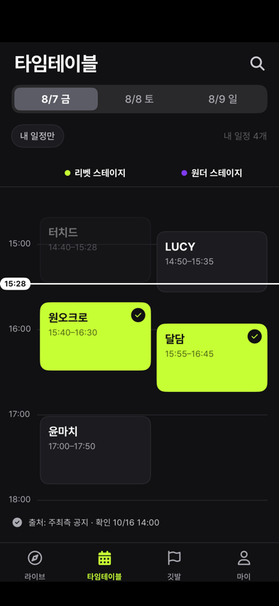
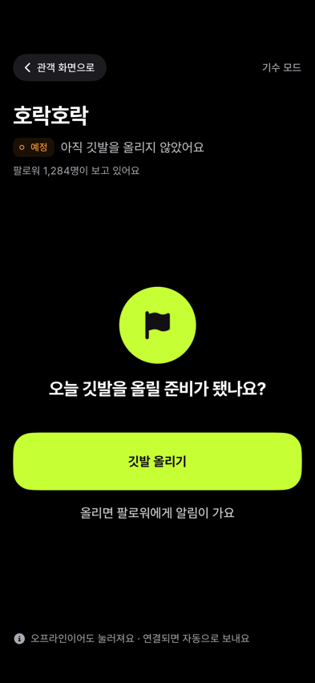
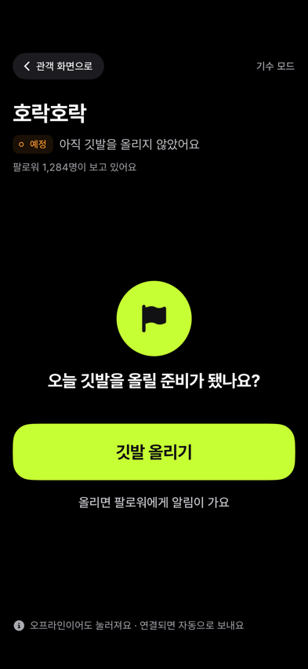
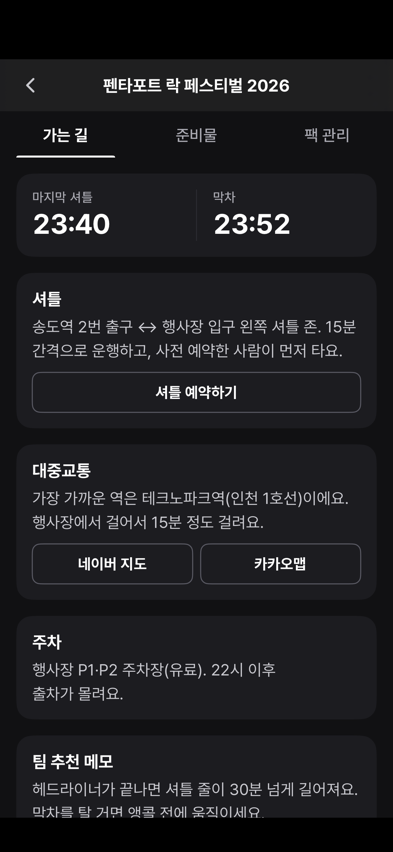
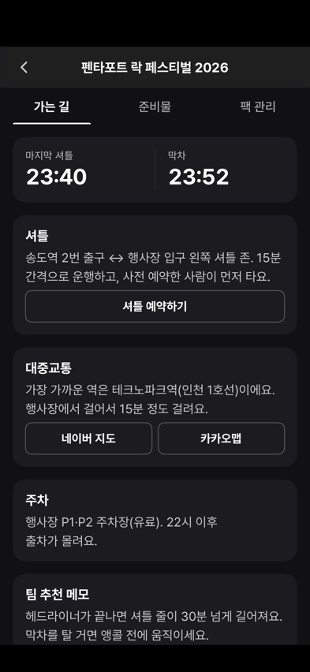

# 최신 .fig 디자인 수정과 검증

최신 `FESTICORE (복사).fig`를 주 기준으로 원본과 대조했다. 원본 SHA256은 `7c093f507a97793aecef7379d68d580c9acc2a6779db650c0d5a0fa16fd4e6fe`, 최신 복사본은 `7669295fdbc34cea802d937e1ecb990772d65ecdbb570ca0e54e4e9817b4f575`다. 원본 204개에서 최신 230개 Sxx 프레임으로 늘었으며 전체 대응표는 [화면 목록](design-screen-matrix-20261127.md)에 있다. 목록의 미검증 표시는 실제로 모든 화면을 픽셀 대조하지 않았다는 의미다.

## 변경과 증거

| 항목 | 원본/이전 | 변경/검증 |
|---|---|---|
| S09 CTA | 최신 293:548/293:557 instance override의 fontSize22, lineHeight30; 이전 코드16pt | 기존 baseTitle2Bold/linebox 재사용; 시작·재시작 사용처 고정 상태 캡처. 320/393pt·AX5 환경에 긴 문구 추가; 단일 줄 말줄임을 재현하고 줄바꿈/최소72pt 높이로 보완 |
| S02 출처 | 최신 원본 fillPaints 빈 배열; 이전 기본 SourceLine 배경띠 | 기존 inset(false)와 기존16/12pt 여백 재사용; 새 실제 simulator 캡처 확인 |
| S02 세 스테이지 | 스크롤 자동 이동의 top anchor가 수평 중앙 이동 유발 | topLeading으로 첫 열/시간 축 보존 |
| S11 안내 카드 | 최신313:16508 body→actions gap8pt; 이전12pt | directionSection 외부 간격을 기존 paddingP8로 변경, 가는 길 새 캡처 확인 |
| S03 시트 | 정적 FCSetSheet 캡처 하단 잘림 없음 | MainTabView의 실제 fcModal 경로를320×667/393×852에서 캡처; 일정 토글·출처 하단 잘림 재현 안 됨 |
| S04 정렬 | 현재 develop도 toolbar overlay + zIndex 구현 | 메뉴 열기 전후 새 캡처에서 첫 카드 y292·다음 카드 y450 유지, 목록 밀림 재현 안 됨 |

`FCBearerCTA`는 docs/core-ui-modules-design.md에 명시된 수작업 Component 영역이다. 사용자 위임 승인으로 저장소 로컬 수정 예외를 적용했다. 생성된 Token이나 외부 DesignSystem은 바꾸지 않았으며 전역 원천 토큰 반영은 필요하지 않다. 동일 CTA는 BearerBoard 시작/재시작과 DesignKit Demo/Preview에서 재사용한다. 시작/재시작·320/393pt·긴/기본 문구·라이트/다크 16개 조합을 추가 캡처했다. Demo를 별도 실행한 증거는 없다. 기존 토큰 UIFont는 고정 크기이므로 AX5 캡처가 Dynamic Type 확대 지원을 증명하지는 않는다.

재사용 사다리: 기존 토큰·linebox, inset(false), spacingP8, XCTest capture helper를 사용했다. 새 컴포넌트/의존성/전역 보정 없이 수정했다. 단순화 점검: CTA 기본 문구와 색상 분기는 유지하고 변경은 폰트·줄바꿈·최소 높이에 한정했다. Claude 교차검토는 주인 승인에 따른 `unreviewed-spec override`이며 자체 검증 결과와 구분한다.

## 새 로컬 증거

증거 루트: `/Users/suhwonji/orca/reports/item6-ios-design-20261127/`

- `before.xcresult`, `before/`: 변경 전 실제 simulator 4개 캡처 테스트 통과.
- `after-first.xcresult`, `after-first/`: 변경 후4개 캡처 테스트 및 Timetable54/Bearer98/Profile83/DesignKit27개 테스트 통과(총262 reducer/component tests).
- `after-wrap.xcresult`, `after-wrap/`: 긴 문구 보완 후2개 캡처 테스트 통과. `S09-CTA-320-long-AX5.png`에서 두 줄 전체 노출 확인.
- before/after의 S02-A-basic, S02-F-three-stages, S09-I-scheduled, S11-directions를 대조한다.

테스트는 고정 상태 화면을 simulator의 UIHostingController로 렌더했다. 실행 중인 앱 사용자 조작·운영 응답·실기기 권한·전체 safe-area 경로의 검증과 다르다. 과거 204 PNG/37 geometry tests를 전체 일치 근거로 쓰지 않았다. 최신230프레임 전체 일치, 전체 폰트/아이콘/간격, 실제 서버를 통한 크루 nickname 가입/편집, 실제 로그인과 권한 흐름은 미완료다. 기존 plan 저장 및 깃발 축제 이동 구현은 유지했다.

## PR에서 볼 수 있는 전후 캡처

| 화면 | 변경 전 | 변경 후 |
|---|---|---|
| S02-A-basic |  |  |
| S09-I-scheduled |  |  |
| S11-directions |  |  |

추가 `modal-menu-cta.xcresult`: 3 tests passed. [S03 좁은 화면](assets/20261127/S03-main-tab-overlap-320.png), [S03 일반 화면](assets/20261127/S03-main-tab-overlap-393.png), [S04 메뉴 닫힘](assets/20261127/S04-A-basic.png), [S04 메뉴 열림](assets/20261127/S04-sort-menu.png), [S09 재시작 라이트 긴 문구](assets/20261127/S09-CTA-restart-320-long-light-AX5.png).
